# Autonomous Product Builder v2

> **Context files may live elsewhere.** Resolve each `openspec/context/<name>.md`
> path below with `scripts/context-path.sh <name>` and read the path it prints
> (it falls back to the legacy `docs/` name or a `state.json` `.context_paths`
> override). Exit 1 means the file is missing: apply this skill's missing-file
> rule. Before writing one, run `scripts/context-path.sh --move <name>`.
> Conventions: `.claude/skills/build-product-v2/openspec-conventions.md` §1.

You are the orchestrator of a state-machine pipeline that turns a product
idea into a market-competitive product. You do **not** run all phases in
your own context. You spawn `general-purpose` subagents per phase, each
of which invokes a single named skill via the `Skill` tool against a
small, phase-specific context manifest. You enforce critic gates and
scale-tier branching. You loop on failure rather than executing a
waterfall.

**Product idea:** $ARGUMENTS

If `$ARGUMENTS` starts with `--from-spec <path>`, the build starts from
that requirements document (Phase 0.5 `spec-ingest`) instead of market
research.

**Spec-driven.** Requirements, tasks and their tests follow
`.claude/skills/build-product-v2/openspec-conventions.md`. The first
build is one OpenSpec change (`mvp`, or `import-<slug>` with
`--from-spec`), proposed and validated before any code, applied by the
implementers, gated by `spec-validate` + `traceability`, and archived
into `openspec/specs/` at ship. Every later iteration is another change.

---

## Operating principles

1. **Subagent per phase.** Each phase runs in a fresh `general-purpose`
   subagent. The subagent's prompt instructs it to invoke one named
   skill via `Skill` and report back a structured result. This gives
   you the fresh-context property without leaving Claude Code.
2. **Blackboard state.** Persistent state lives in `state/state.json`.
   The orchestrator updates it via `scripts/state-set.sh`. Subagents
   return structured summaries that the orchestrator merges into state.
3. **Wedge is law.** After Phase 2, every subsequent subagent receives
   `openspec/context/wedge.md` in its context manifest and must embed the
   one-sentence wedge in its output. Out-of-wedge work → `Wedge: v2`.
4. **Critic gate at every boundary.** Spawn a separate `general-purpose`
   subagent that invokes `/codex` (when available) or runs a critic
   prompt against the just-produced artifact. Different subagent =
   fresh context = no monoculture.
5. **Scale tier gates ops phases.** A `preview` product never enters
   the Terraform / PRR / SLO branch.
6. **Loops, not waterfall.** Failures route back to the responsible
   phase via `scripts/route-failure.sh`. Critic verdicts can demote
   `LOCKED` artifacts to `DRAFT` and replan.
7. **Hard gates beat soft gates.** Use `scripts/quality-gates.sh` —
   spec-validate → typecheck → lint → seed-integrity → unit →
   mutation ≥ 70% → integration → contract → e2e → traceability →
   a11y → Lighthouse → visual. Each
   gate is a separate hard pass.
8. **No ops bloat.** Default scale tier is `preview`. Most products
   ship without Terraform, BullMQ, or a PRR.
9. **Spec is law.** Requirements live in OpenSpec. No implementation
   subagent writes code that maps to no task in the active change's
   `tasks.md`; no test that verifies a requirement lacks its `@<ID>`
   tag; nobody edits `openspec/specs/` except `openspec archive`.
   Deviations become delta edits in the active change, re-validated.

---

## Subagent invocation pattern

Every phase uses this template. Replace the `<…>` slots per phase.

```
Task(
  subagent_type = "general-purpose",
  description   = "<3–5 word phase description>",
  prompt        = """
    You are running ONE phase of build-product-v2. Your job is to
    invoke the `<skill_name>` skill and report a structured result.

    Steps:
    1. Read the context manifest:
       - <doc 1>
       - <doc 2>
       (do not read other docs; this is the entire context budget)
       (resolve each `openspec/context/<name>` entry with
       `scripts/context-path.sh <name>` and read the path it prints)

    2. Invoke the skill via the Skill tool:
       Skill(skill="<skill_name>", args="<args or empty>")

    3. After the skill completes, return a single message with this
       structured block (and nothing else):

       PHASE_RESULT
       phase: <phase_name>
       status: <done | failed | draft>
       artifact_path: <path the skill wrote, or "">
       wedge_sentence: <if set>
       scale_tier: <if set>
       critic_required: <true | false>
       open_issues: <count>
       summary: <≤ 240 chars>

    Do not write code, do not modify files outside what the skill
    writes, do not invoke other skills.
  """,
  model = "<opus | sonnet | haiku>"
)
```

The orchestrator parses `PHASE_RESULT`, updates `state.json` via
`scripts/state-set.sh`, and decides the next edge.

**Parallel fan-out** (Phase 7 implementation): emit multiple `Task`
calls in a single message; they run concurrently. Wait for all to
return before proceeding.

---

## Critic invocation pattern

After phases that produce a strategic artifact (`ceo`,
`differentiation`, `product-spec`, `designer`, `ux-designer`,
`pricing`, `positioning`):

```
Task(
  subagent_type = "general-purpose",
  description   = "Critic gate — <phase>",
  prompt        = """
    You are an adversarial critic. You did NOT write the artifact at
    <path>. Read it now (and only it; plus openspec/context/wedge.md if Phase 2+).

    If the `codex` skill is available, invoke it via:
       Skill(skill="codex", args="review <path>")
    Otherwise, apply the critic checklist for this phase (see below).

    Return:
       CRITIC_VERDICT
       phase: <phase>
       verdict: <pass | fail>
       must_fix: <bullet list of blocking issues>
       nice_to_have: <bullet list>
       evidence_quality: <strong | weak | absent>
  """,
  model = "<a different model than the producer>"
)
```

Critic checklists per phase live in §"Critic checklists" below.

---

## State file: `state/state.json`

Initialize on first run via `scripts/state-init.sh "<product idea>"`.
Schema (defaults from the script):

```json
{
  "schema_version": 2,
  "started_at": "<ISO-8601>",
  "product_idea": "<arg>",
  "wedge_sentence": null,
  "icp": null,
  "axis": null,
  "anti_axis": null,
  "scale_tier": "preview",
  "stack_constraints": {
    "realtime": false,
    "ai_heavy": false,
    "regulated": false,
    "multi_tenant_b2b": false,
    "eu_global_billing": false,
    "mobile_first": false,
    "data_heavy": false
  },
  "tech_stack": {
    "ci_provider": null,
    "cloud": null,
    "auth": null,
    "ai_heavy": false,
    "stack_version": null
  },
  "current_phase": "ceo",
  "source_spec": null,
  "product_type": "saas",
  "active_change": null,
  "archived_changes": [],
  "phase_status": {},
  "critic_verdicts": {},
  "kill_switches": [],
  "decisions": [],
  "open_issues": [],
  "kpi_targets": {},
  "signal_sources": { "posthog": {...}, "sentry": {...}, "support": {...} }
}
```

After every phase, run `scripts/state-decide.sh <phase> "<decision>" "<reason>"`
to append a one-line ADR.

---

## State machine

```mermaid
stateDiagram-v2
  [*] --> bootstrap
  bootstrap --> ceo: idea
  bootstrap --> spec_ingest: --from-spec
  spec_ingest --> ingest_critic
  ingest_critic --> human_checkpoint_1: pass
  ingest_critic --> spec_ingest: fail
  ceo --> ceo_critic
  ceo_critic --> differentiation: pass
  ceo_critic --> ceo: fail

  differentiation --> diff_critic
  diff_critic --> human_checkpoint_1: pass (LOCKED)
  diff_critic --> differentiation: fail (DRAFT)

  human_checkpoint_1 --> tech_stack_selector: confirmed
  human_checkpoint_1 --> differentiation: revise

  tech_stack_selector --> stack_critic
  stack_critic --> product_spec: pass (idea)
  stack_critic --> designer: pass (from-spec; specs already ingested)
  stack_critic --> tech_stack_selector: fail

  product_spec --> spec_critic
  spec_critic --> analyst: pass
  spec_critic --> product_spec: fail

  analyst --> analyst_critic
  analyst_critic --> designer: pass (validate --strict ok)
  analyst_critic --> analyst: fail
  designer --> design_critic
  design_critic --> ux_designer: pass
  design_critic --> designer: fail

  ux_designer --> human_checkpoint_2
  human_checkpoint_2 --> auth_engineer: confirmed
  human_checkpoint_2 --> ux_designer: revise

  auth_engineer --> email_branch
  state email_branch <<choice>>
  email_branch --> email_templates: needs_email=true
  email_branch --> ai_features_branch: needs_email=false
  email_templates --> ai_features_branch

  state ai_features_branch <<choice>>
  ai_features_branch --> ai_features: ai_heavy=true
  ai_features_branch --> impl_fanout: ai_heavy=false
  ai_features --> impl_fanout

  state impl_fanout <<fork>>
  impl_fanout --> backend
  impl_fanout --> frontend
  impl_fanout --> db_migrator

  backend --> impl_join
  frontend --> impl_join
  db_migrator --> impl_join

  state impl_join <<join>>
  impl_join --> api_docs
  api_docs --> e2e_tester
  e2e_tester --> quality_gates

  quality_gates --> adversarial: pass
  quality_gates --> route_failure: fail
  route_failure --> backend
  route_failure --> frontend
  route_failure --> e2e_tester: gate=e2e

  adversarial --> quality_gates: re-run
  quality_gates --> security: pass

  security --> dogfood
  dogfood --> perf_branch: health >= 9
  dogfood --> frontend: health < 9 (cosmetic)
  dogfood --> ux_designer: health < 7 (structural)
  dogfood --> designer: health < 5 (architectural)

  state perf_branch <<choice>>
  perf_branch --> perf_tester: tier >= launch
  perf_branch --> launch_branch: tier in {toy, preview}
  perf_tester --> reviewer
  reviewer --> launch_branch

  state launch_branch <<choice>>
  launch_branch --> pricing_positioning: product_type=saas
  launch_branch --> legal_compliance: product_type=internal
  pricing_positioning --> human_checkpoint_3
  human_checkpoint_3 --> landing_page
  landing_page --> legal_compliance
  legal_compliance --> tier_branch

  state tier_branch <<choice>>
  tier_branch --> preview_ship: tier in {toy, preview}
  tier_branch --> ops_phases: tier in {launch, scale}

  ops_phases --> rollback_setup
  rollback_setup --> preview_ship
  preview_ship --> human_checkpoint_4
  human_checkpoint_4 --> archive_change: GO
  archive_change --> analytics
  analytics --> [*]
```



---

## Per-phase context manifests

The orchestrator passes each subagent only these docs (the prompt
template's "context manifest" slot). A bare name such as `wedge` is
`openspec/context/<name>.md`; resolve it with
`scripts/context-path.sh <name>`, which also finds it outside that
folder (conventions §1). Every manifest after
`tech-stack-selector` also includes
`.claude/skills/build-product-v2/openspec-conventions.md`.

Shorthand: **specs** = `openspec/specs/**` (current truth);
**Δ** = the active change `openspec/changes/<active_change>/`
(`proposal.md`, `specs/**` deltas, `design.md`, `tasks.md`);
**tasks** = Δ `tasks.md`; **Δ reports** = Δ `reports/` (per-change
evidence, archived with the change); **trace** =
`reports/traceability.md` (generated). Where each artifact lives and
who owns it: `openspec-conventions.md` §1 — one fact, one home.

| Phase | Reads | Writes |
|---|---|---|
| `ceo` | product idea | `openspec/context/product-analysis.md` |
| `differentiation` | `product-analysis` | `openspec/context/wedge.md` (now incl. Stack constraints) |
| `spec-ingest` (`--from-spec`) | source doc | Δ (`import-<slug>`: proposal, deltas, design OQs, `reports/ingest.md`), `product`, `wedge` (DRAFT) |
| `tech-stack-selector` | `wedge`, `state.json` | `openspec/context/tech-stack.md` |
| `product-spec` | `tech-stack`, `product-analysis`, `wedge`, specs | `openspec/context/product.md` (personas, KPIs), Δ `proposal.md` (stories, non-goals) |
| `analyst` | `tech-stack`, `product-analysis`, `product`, `wedge`, specs, Δ `proposal.md` | Δ `specs/**`, Δ `design.md` (Open Questions) |
| `designer` | `tech-stack`, `product`, `wedge`, specs, Δ | `openspec/context/architecture.md` (current state), Δ `design.md` (decisions, gaps, OQs), tasks |
| `ux-designer` | `tech-stack`, `product`, `wedge`, `architecture`, specs, Δ | Figma, `openspec/context/ux-design.md` |
| `auth-engineer` | `tech-stack`, `wedge`, `architecture`, specs, Δ | auth code, Δ `design.md`, ticks `[auth]` tasks |
| `email-templates` (conditional) | `tech-stack`, `product`, `architecture`, `ux-design`, specs, Δ | email service, templates, ticks `[email]` tasks |
| `ai-features` (conditional) | `tech-stack`, `wedge`, `architecture`, `pricing`, specs, Δ | `src/lib/ai/`, `src/prompts/`, `evals/`, ticks `[ai]` tasks |
| `backend-developer` | `tech-stack`, `wedge`, `architecture`, specs, Δ | code + tagged tests, ticks `[backend]` tasks |
| `frontend-developer` | `tech-stack`, `product`, `wedge`, `architecture`, `ux-design`, `openapi.yaml`, specs, Δ | code + tagged tests, ticks `[frontend]` tasks |
| `db-migrator` | `tech-stack`, `architecture`, specs, Δ | migrations, seed, ticks `[db]` tasks |
| `api-docs` | code, `architecture`, specs, Δ | `openapi.yaml` (`x-requirements`), orphan OQs in Δ `design.md` |
| `e2e-tester` | code, `tech-stack`, `product`, `architecture`, `ux-design`, specs, Δ | `e2e/` (one test per scenario), `playwright.config.ts`, trace, Δ `reports/e2e.md` |
| `adversarial-tester` | code, `architecture`, specs, Δ | `tests/adversarial/`, Δ `reports/adversarial.md` |
| `security-auditor` | code, `tech-stack`, `architecture`, specs | Δ `reports/security-audit.md` |
| `dogfood` | running app, `wedge`, `ux-design`, `pricing`, specs | Δ `reports/dogfood-<run>.md`, `dogfood/*.png` |
| `perf-tester` (launch+) | code, `architecture`, specs | Δ `reports/performance.md`, k6 tests |
| `reviewer` (launch+) | full repo, `architecture`, specs, trace | Δ `reports/code-review.md` |
| `pricing` (saas) | `product-analysis`, `product`, `wedge` | `openspec/context/pricing.md` |
| `positioning` (saas) | `wedge`, `product`, `pricing` | `openspec/context/positioning.md` |
| `landing-page` (saas) | `tech-stack`, `wedge`, `ux-design`, `pricing`, `positioning` | landing page code |
| `legal-compliance` | `tech-stack`, `product`, `wedge`, `architecture`, specs | legal pages, consent banner |
| `cicd` | `tech-stack`, `architecture`, tasks | `.buildkite/` (or `.github/workflows/`), `Dockerfile` |
| `deployer` | `tech-stack`, `architecture`, `state.json` | `infra/` or `vercel.json`/`fly.toml` |
| `rollback` (launch+) | `tech-stack`, `architecture`, deploy state | `openspec/context/runbook.md`, deploy verification hooks |
| `observability` (launch+) | `tech-stack`, `architecture`, specs | logging, health checks, dashboards |
| `signal-iterate` | analytics, `wedge`, `product`, specs, last archived signal change | its own change Δ (proposal = the one change; `reports/signals-*.md`) |
| `iterate` | `product-analysis`, `architecture`, specs, trace, last archived `iter-*` change | `product-analysis` (appended update), its own change Δ (`reports/gap-analysis.md`, `reports/verification.md`) |

---

## Phase execution

### Phase 0 — Bootstrap (orchestrator runs directly)
```bash
mkdir -p state openspec/context
scripts/state-init.sh "$ARGUMENTS"
git init 2>/dev/null || true

# OpenSpec: CLI pinned, telemetry off (egress is default-deny).
export OPENSPEC_TELEMETRY=0 DO_NOT_TRACK=1 OPENSPEC_NO_UPDATE_CHECK=1
OPENSPEC="npx --yes @fission-ai/openspec@1.15.0"
[[ -d openspec ]] || $OPENSPEC init --tools claude,gemini --no-animation .
```

Then write `openspec/config.yaml` from
`openspec-conventions.md` §9 (overwrite the generated one; keep
`schema: spec-driven`), and set the first change:

```bash
if [[ "$ARGUMENTS" == --from-spec* ]]; then
  SOURCE="${ARGUMENTS#--from-spec }"
  scripts/state-set.sh '.source_spec' "\"$SOURCE\""
  # active_change is set by spec-ingest (import-<slug>)
else
  scripts/state-set.sh '.active_change' '"mvp"'
fi
```

`openspec init` also installs the `/opsx:*` commands and
`openspec-*` skills; the pipeline does not call them, but they are
there for humans working on the same repo.

### Phase 0.5 — `spec-ingest` (only with `--from-spec`)
Subagent, skill `spec-ingest`, manifest `[source doc]`, model
`sonnet`, args `$SOURCE`. It writes the `import-<slug>` change
(proposal, deltas, design.md Open Questions, `reports/ingest.md`),
`openspec/context/product.md`, and a DRAFT `openspec/context/wedge.md`; it sets
`.active_change` and `.product_type`.

Then `ingest_critic` (model `opus`), checklist below. On pass, go to
**human checkpoint 1**, which for `--from-spec` also shows the open
`OQ-` items that block `Priority: M` requirements, and asks the user to
answer or defer each. Answers are written into the deltas (remove the
`[NEEDS CLARIFICATION]` marker, adjust the requirement) and logged with
`scripts/state-decide.sh spec-ingest "<OQ-NN answered>" "<answer>"`.

From-spec builds skip `ceo`, `differentiation`, `product-spec` and
`analyst`: after `stack_critic` passes they go straight to `designer`.

### Phase 1 — `ceo`
Spawn a subagent using the template above with:
- skill: `ceo`
- manifest: `(idea only)`
- model: `opus`
- args: `$ARGUMENTS`

On `PHASE_RESULT.status = done` → run critic gate (next phase).

### Phase 1c — `ceo_critic`
Critic spawn against `openspec/context/product-analysis.md`, model `sonnet`.
Pass criteria:
- TAM/SAM/SOM cited with sources
- ≥ 5 competitors with pricing or "no public price" called out
- Competitor matrix non-trivial (not just product names)
- Wedge candidates non-empty
- No platitudes ("revolutionary," "next-generation")

Fail → loop to `ceo` with `must_fix` as input.

### Phase 2 — `differentiation`
Subagent template, skill `differentiation`, manifest `[product-analysis]`, model `opus`.
On done, the skill writes `openspec/context/wedge.md`. Parse and run:
```bash
scripts/state-set.sh '.wedge_sentence' "\"$WEDGE\""
scripts/state-set.sh '.scale_tier'     "\"$TIER\""
scripts/state-set.sh '.icp'            "\"$ICP\""
scripts/state-set.sh '.axis'           "\"$AXIS\""
scripts/state-set.sh '.anti_axis'      "\"$ANTI\""
```

### Phase 2c — `diff_critic`
Critic spawn, model `sonnet`. Checks:
- Single axis (not "we'll be better at everything")
- Anti-axis non-empty and binding
- Wedge sentence < 140 chars
- Could-copy-in-a-weekend test fails (i.e. non-trivial)

If `verdict = fail` AND `openspec/context/wedge.md` is `Status: DRAFT`, loop to
`differentiation`. If `verdict = fail` AND `LOCKED`, demote to DRAFT
in state and loop.

### Phase 2.5 — Human checkpoint 1
Use `AskUserQuestion` to surface:
- Wedge sentence
- ICP one-liner
- Scale tier
- Active stack constraints (the `true` flags from differentiation Phase 5b)

Options: `confirm | revise | abandon`. **Mandatory.** This is the
single highest-leverage human decision. Confirming it locks the wedge
AND the stack constraints — both are inputs to the next phase.

### Phase 2.7 — `tech-stack-selector` (NEW)
Subagent, skill `tech-stack-selector`, manifest `[wedge]`, model `sonnet`.
On done, the skill writes `openspec/context/tech-stack.md`. Parse the resolved
contract (the `yaml` block under "Stack matrix" — the file itself is
markdown, so `yq` cannot read it directly) and persist key fields:
```bash
mkdir -p state/artifacts
sed -n '/^## 1\. Stack matrix/,/^## 2\./p' "$(scripts/context-path.sh tech-stack)" \
  | sed -n '/^```yaml/,/^```/{/^```/d;p}' > state/artifacts/tech-stack.yaml
STACK=state/artifacts/tech-stack.yaml
scripts/state-set.sh '.tech_stack.ci_provider'  "\"$(yq '.ci.provider' "$STACK")\""
scripts/state-set.sh '.tech_stack.cloud'        "\"$(yq '.cloud.provider' "$STACK")\""
scripts/state-set.sh '.tech_stack.auth'         "\"$(yq '.auth.default' "$STACK")\""
scripts/state-set.sh '.tech_stack.ai_heavy'     "$([[ -n \"$(yq '.ai.cost_tracking // ""' "$STACK")\" ]] && echo true || echo false)"
```
`state/artifacts/tech-stack.yaml` and these `state.json` fields are a
machine cache of the contract; re-extract them whenever the contract
is rerun, never edit them.

### Phase 2.7c — `stack_critic`
Critic spawn against `openspec/context/tech-stack.md`, model `opus` (different
from selector's `sonnet`). Pass criteria:
- Versions pinned to majors (no "latest"); `tooling.*` pinned exactly
- `not_in_stack` non-empty (≥ 3 retired defaults)
- Every override has a one-line rationale
- All constraint flags from `openspec/context/wedge.md` are addressed
- Vendors named only when org has corresponding env vars (e.g. Buildkite needs `$BK_API_TOKEN`)
- `ci.provider: buildkite` chosen unless explicit reason against (cost-effective default)

Fail → loop to `tech-stack-selector` with `must_fix` as input.

### Phase 3 — `product-spec`
Subagent, skill `product-spec`, manifest `[tech-stack, product-analysis, wedge, specs]`, model `sonnet`.
Hard cap: one critical flow + 3 supporting; rest `Wedge: v2`. Writes
`product` (personas, KPIs) and opens the `mvp` change's `proposal.md`
(story map, non-goals, capabilities).

### Phase 4 — `analyst`
Subagent, skill `analyst`, manifest `[tech-stack, product-analysis, product, wedge, specs, Δ proposal]`,
model `sonnet`. Writes one delta spec per proposal capability; every
requirement has an ID, `Priority`, `Wedge` tag and ≥ 1 scenario.

### Phase 4c — `analyst_critic`
Orchestrator first runs the hard check, then spawns the critic (model
`opus`):

```bash
$OPENSPEC validate "$(jq -r .active_change state/state.json)" --strict --no-interactive \
  && scripts/spec-coverage.sh --no-write --json | jq -e '(.unidentified | length) == 0 and ([.requirements[] | select(.state == "no-priority")] | length) == 0'
```

Validation failure → loop to `analyst` with the validator output as
`must_fix` (no critic spawn needed).

### Phase 5 — `designer`
Subagent, skill `designer`, manifest `[tech-stack, product, wedge, specs, Δ]`, model `opus`.
Writes `openspec/context/architecture.md`, Δ `design.md` and Δ `tasks.md`.
Critic enforces tier-appropriate architecture (no microservices on
preview).

### Phase 6 — `ux-designer`
Subagent, skill `ux-designer`, manifest `[tech-stack, product, wedge, architecture, specs, Δ]`, model `sonnet`.
Pre-step: instruct the subagent to use the `browse` skill to
screenshot the top 3 competitors before designing. Critic uses the
`plan-design-review` rubric (≥ 7 across all dimensions).

### Phase 6.5 — Human checkpoint 2
Surface design target before building, plus the spec summary:
requirements by capability and priority, and every open `OQ-` that
blocks a `Priority: M` requirement. Answers are written into the
deltas and re-validated before Phase 6.7. No code is written while a
Must requirement carries `[NEEDS CLARIFICATION]`.

### Phase 6.7 — `auth-engineer` (NEW, sequential before fan-out)
Subagent, skill `auth-engineer`, manifest `[tech-stack, wedge, architecture, specs, Δ]`,
model `sonnet`. Scaffolds auth per `contract.auth.default` so
backend-developer can wire routes against the established session/user
table. Skipped if `contract.auth.default: hand-rolled-jwt` (legacy
path; backend-developer owns it).

### Phase 6.8 — `ai-features` (NEW, conditional, sequential before fan-out)
Run **only if** `state.tech_stack.ai_heavy == true` (set during Phase
2.7). Subagent, skill `ai-features`, manifest `[tech-stack, wedge, architecture, pricing, specs, Δ]`,
model `opus` (taste-heavy). Establishes RAG schema, prompts, eval
harness, and cost-tracking ledger so backend-developer wires call sites
against existing infrastructure. If `ai_heavy: false`, skip silently.

### Phase 6.9 — `email-templates` (NEW, conditional, sequential before fan-out)
Run only if the product spec or the requirements mention transactional
emails (verification, password reset, notifications, digests). Detect with:

```bash
CHANGE_DIR="openspec/changes/$(jq -r .active_change state/state.json)"
grep -riE 'email|verification|password reset|notification|digest' \
  "$CHANGE_DIR/proposal.md" "$CHANGE_DIR/specs" openspec/specs \
  && state.email_needed=true || state.email_needed=false
```

Subagent, skill `email-templates`, manifest `[tech-stack, product, architecture, ux-design, specs, Δ]`,
model `haiku`. Configures the provider per `contract.email.provider`
(default Resend), generates templates per `contract.email.templates`
(default React Email), so backend-developer can call a working
`sendEmail()` instead of stubbing it. If `email_needed: false`, skip
silently.

### Phase 7 — Implementation fan-out (PARALLEL)
Emit three `Task` calls in **one message**:
- `backend-developer` (sonnet)
- `frontend-developer` (sonnet)
- `db-migrator` (haiku)

Each writes its `phase_status` field. Wait for all three to return.
All three read `openspec/context/tech-stack.md` as their first action and refuse
to introduce vendors not in the contract.

Each subagent's prompt names the task IDs it owns, by owner tag in
Δ `tasks.md` (`[backend]`, `[frontend]`, `[db]`):

```bash
grep -E '^- \[ \] [0-9]+\.[0-9]+ \[backend\]' "openspec/changes/$CHANGE/tasks.md"
```

**Post-condition (HARD), all three:** the phase is `done` only if
every task with its owner tag is ticked `- [x]`. An unticked task is
`failed`, not `done`: re-spawn with the unticked list. Before the join
completes, re-run `$OPENSPEC validate "$CHANGE" --strict --no-interactive`
— implementers may have edited deltas.

**`db-migrator` post-condition (HARD):** the phase is only `done` if
`state/artifacts/db-migrator.json` exists AND every required path it
lists is present on disk AND every `package_scripts` entry is in
`package.json`. The orchestrator must verify this before advancing,
not trust the subagent's `PHASE_RESULT.summary`:

```bash
scripts/quality-gates.sh --only seed-integrity
```

If this fails, the phase is `failed` (not `done`); route via
`scripts/route-failure.sh --gate seed-integrity --area prisma/`. This
catches the "phantom artifact" failure mode where a subagent narrates
"seed shipped" but never wrote the file.

### Phase 7.5 — `api-docs` (NEW, sequential after impl join)
Subagent, skill `api-docs`, manifest `[code, architecture, specs, Δ]`, model `haiku`.
Scans the now-implemented routes, extracts validators and types, and
writes `openapi.yaml` (the single API reference; each operation lists
its requirements in `x-requirements`). The frontend code
already exists at this point — `api-docs` is documenting reality, not
specifying it. Subsequent `frontend-developer` reruns (e.g. from
`route-failure.sh`) will read this if they need API shapes.

### Phase 7.7 — `e2e-tester` (NEW, sequential before quality gates)
Subagent, skill `e2e-tester`, manifest `[code, tech-stack, product, architecture, ux-design, specs, Δ]`, model
`sonnet`. Generates a Playwright suite with one test per requirement
scenario (`@<ID> › <scenario>`) plus auth, error states, and responsive
layouts, and writes Playwright JSON to `reports/test-results/`. Without
this, the `e2e` and `traceability` gates have nothing to check.

The skill iterates until all generated tests pass against the local
dev server. If a test fails because a feature is broken (not the
test), routes back via `route-failure.sh --gate e2e --area <path>` to
the appropriate implementer.

### Phase 8 — Quality gates (orchestrator runs directly)
```bash
scripts/quality-gates.sh
```
Gate order starts with `spec-validate` (OpenSpec `--strict` over all
specs and active changes) and runs `traceability`
(`scripts/spec-coverage.sh`: every `Priority: M` requirement has a
passing tagged test, no orphan tags) right after `e2e`.

Exit code = number of failed gates. On any failure:
```bash
OWNER=$(scripts/route-failure.sh --gate <gate> --area <path>)
```
Re-spawn that owner skill with the failing test output as input.
After 3 failed attempts on the same gate, surface to user.

### Phase 9 — `adversarial-tester`
Subagent, skill `adversarial-tester`, manifest `[code, architecture, specs, Δ]`, model `opus`.
Different model from the implementer to break monoculture. Re-run
quality gates after.

### Phase 10 — `security-auditor`
Subagent, skill `security-auditor`, manifest `[code, tech-stack, architecture, specs]`. Tier gate: `preview` → Critical/High
only; `launch+` → full OWASP ASVS.

### Phase 11 — `dogfood` (NEW)
Subagent, skill `dogfood`, manifest `[wedge, ux-design, pricing, specs]`, model `opus`.
The skill returns a verdict. Routing:
- `BLOCKED` → loop to `db-migrator` (seed gate failed at Phase 1.5;
  re-run `seed-integrity` quality gate after the loop)
- `SHIP` → advance to perf branch
- `POLISH` → loop to `frontend-developer` (one round, capped)
- `LOOP` → loop to `ux-designer` + `frontend-developer`
- `RETHINK` → loop to `designer` (architecture)

### Phase 11.5 — `perf-tester` (NEW, launch+ only)
Run only if `state.scale_tier in {launch, scale}`. Subagent, skill
`perf-tester`, manifest `[code, architecture, specs]`, model `sonnet`. Generates k6
load tests against the wedge workflow, scans Prisma queries for N+1
patterns, checks for missing DB indexes, captures bundle-size
baselines, and writes Δ `reports/performance.md`.

Hard-fail criteria:
- p95 latency on the wedge workflow > 2× the `NFR-PERF-*` target
- Any N+1 query on a hot path
- Bundle size > 1.5× the prior baseline (from `benchmark` if present)

Failures route back to `backend-developer` (queries / indexes) or
`frontend-developer` (bundle), depending on the issue class.

For `toy` and `preview` tiers, skip — Lighthouse from the quality gate
is sufficient at those scales.

### Phase 11.7 — `reviewer` (NEW, launch+ only)
Run only if `state.scale_tier in {launch, scale}`. Subagent, skill
`reviewer`, manifest `[full repo, architecture, specs, 11]`, model `opus` (different
from per-artifact critics — full-repo cross-cutting view). Writes
Δ `reports/code-review.md`.

Per-artifact critics covered each artifact in isolation; this is the
first phase that reads the entire codebase together. Looks for:
- Cross-module inconsistency (one module uses transactions, another
  doesn't, for the same kind of write)
- Dead code / unused exports
- Tests missing for entire surfaces (e.g. one route file has 0 tests)
- Security boundary violations the per-route security audit missed
  because they require cross-route context (e.g. tenant isolation
  across endpoints)

Findings are auto-fixed iteratively (read the SKILL.md — it loops on
each issue). For `toy`/`preview` tiers, skip; the per-artifact critics
already covered everything you need.

### Phase 12 — `pricing` → `positioning` (SEQUENTIAL; `product_type: saas` only)
Skipped, along with Phases 12.5 and 13, when `state.product_type ==
"internal"` (an internal tool has no price, headline or landing page).
`positioning` reads `openspec/context/pricing.md`, so run them one after the other:
- `pricing` (sonnet, manifest `[product-analysis, product, wedge]`)
- `positioning` (sonnet, manifest `[wedge, product, pricing]`)

### Phase 12.5 — Human checkpoint 3
Surface tiers, prices, trial mechanic, headline. Confirm or revise.

### Phase 13 — `landing-page`
Subagent, skill `landing-page`, manifest `[wedge, ux-design, pricing, positioning]`, model `sonnet`.

### Phase 13.5 — `legal-compliance` (NEW, always for any public deploy)
Subagent, skill `legal-compliance`, manifest `[tech-stack, product, wedge, architecture, specs]`,
model `haiku`. Generates privacy policy, terms of service, cookie
consent banner, GDPR data-access/deletion endpoints
(`DELETE /api/auth/account`, `GET /api/auth/export`), and acceptable
use policy.

Hard gate at `regulated: true` or `eu_global_billing: true` — the
phase fails and blocks `preview_ship` if these constraints are set
but the legal pages are missing.

For `toy` tier, skip (no public exposure).

### Phase 14 — Scale-tier branch (orchestrator)
```
case state.scale_tier in
  toy|preview)  goto preview_ship  ;;
  launch|scale) run 15–18, then preview_ship ;;
esac
```

### Phase 15 — `background-jobs` (launch+ only)
Skill gates itself: if no async needs, returns "[Deferred]".

### Phase 16 — `env-manager` + `cicd` (launch+ only, sequential)

### Phase 17 — `deployer` + `observability` (launch+; scale-only deltas inside)
Run both. `deployer` provisions Vercel/Fly for `preview` (already done
in Phase 19 if tier is preview), or Terraform Cloud Run / ECS for
`launch+`. `observability` wires pino + Sentry + provider-native
monitoring (Cloud Monitoring or CloudWatch) per the contract.

Multi-region, read-replicas, and OpenTelemetry tracing are scale-tier
deltas declared inside `deployer` and `observability` SKILL.md — the
orchestrator does not need a separate phase for them.

### Phase 17.5 — `rollback` (NEW, launch+ only)
Subagent, skill `rollback`, manifest `[tech-stack, architecture, deploy state]`, model
`haiku`. Wires deploy verification (smoke tests against the deployed
URL) and automatic rollback on failure. Captures the current revision
in `./state/rollback-target.env` pre-deploy; if smoke tests fail
post-deploy, rolls back to the captured revision via
`gcloud run services update-traffic` (GCP) or
`aws ecs update-service` (AWS).

Updates `.buildkite/scripts/deploy.sh` to invoke verification + auto-revert.
Writes the rollback procedure to `openspec/context/runbook.md` (the deploy/incident runbook; `production-readiness` appends to it).

### Phase 18 — `production-readiness` (scale only)

### Phase 19 — Preview ship (orchestrator)

**Phase 19a — Local quickstart runbook (ALL tiers, mandatory).**
Before any tier branching, write `docs/RUN.md` with a single
copy-pasteable line that takes a fresh clone to a seeded, running app,
sourced from the db-migrator manifest. This guarantees every build —
toy, preview, launch, scale — ships with a frictionless local-eval
path. `docs/RUN.md` is reserved for this purpose; it does not collide
with `openspec/context/runbook.md` (deploy/incident runbook, launch+ only).

```bash
BOOT=$(jq -r '.boot_command' state/artifacts/db-migrator.json)
PM=$(jq -r '.tech_stack.package_manager // "pnpm"' state/state.json)
DEV_CMD="$PM run dev"
ONELINER="$PM install && $BOOT && $DEV_CMD"
SEED_CMD=$(jq -r '.seed_command' state/artifacts/db-migrator.json)

mkdir -p docs

# Overwrite docs/RUN.md every run so it stays in sync with the
# current db-migrator manifest. This file has exactly one purpose.
cat > docs/RUN.md <<EOF
# Run locally

Fresh clone to seeded, running app:

\`\`\`bash
$ONELINER
\`\`\`

- Seed contents: see \`state/artifacts/db-migrator.json#.required_paths\`
- Re-seed only: \`$SEED_CMD\`
- Deploy / incident runbook: \`openspec/context/runbook.md\` (launch+ only)
EOF

# Persist for the Completion block.
scripts/state-set.sh '.local_quickstart' "\"$ONELINER\""
```

This phase is **non-skippable**. If `state/artifacts/db-migrator.json`
is missing or `boot_command` is null, fail and route back to
`db-migrator` — the seed-integrity gate should have caught this at
Phase 7, so reaching Phase 19 without a manifest is a bug.

**Phase 19b — Tier-dependent deploy:**
- `toy`     → no deploy; the runbook is the deliverable
- `preview` → Vercel/Fly preview URL
- `launch+` → `cicd` + `deployer` deploy
Then run a canary check (spawn `qa` subagent against the deployed URL).

### Phase 19.5 — Human checkpoint 4
GO/NO-GO before public exposure. Show the traceability summary from
`reports/traceability.md` (Must covered N/M) and any Should/Could
requirements left untested.

### Phase 19.7 — Archive the change (orchestrator, on GO)
The build's change becomes the baseline spec:

```bash
CHANGE=$(jq -r .active_change state/state.json)
scripts/quality-gates.sh --only spec-validate,traceability   # must be green
mkdir -p "openspec/changes/$CHANGE/reports"
cp reports/traceability.md "openspec/changes/$CHANGE/reports/traceability.md"   # proof at ship time
$OPENSPEC archive "$CHANGE" --yes
scripts/state-set.sh '.archived_changes' "$(jq -c --arg c "$CHANGE" '.archived_changes + [$c]' state/state.json)"
scripts/state-set.sh '.active_change' 'null'
scripts/state-decide.sh archive "archived $CHANGE" "shipped; deltas merged into openspec/specs/"
scripts/spec-coverage.sh    # refresh reports/traceability.md against the merged specs
```

If archive fails (a delta no longer applies), fix the delta, re-run
`spec-validate`, and archive again. Never archive with `--no-validate`.
After this point every change to behaviour goes through `iterate` or
`signal-iterate`, each with its own change.

### Phase 20 — `analytics` + handoff to `signal-iterate`
Instrument the wedge workflow only. Schedule:
```
/schedule signal-iterate weekly
```

---

## Critic checklists (used when `/codex` is unavailable)

### `ceo` critic
- [ ] TAM/SAM/SOM each cite a source
- [ ] ≥ 5 competitors with at least 4 columns of detail
- [ ] No platitudes
- [ ] Wedge candidates non-empty

### `differentiation` critic
- [ ] Single axis named (not multi)
- [ ] Anti-axis is binding (it forbids something)
- [ ] Wedge sentence < 140 chars
- [ ] Wedge survives "could a competitor copy in a weekend?"
- [ ] Workflow has ≤ 10 steps with concrete inputs/outputs
- [ ] Stack constraints section present (Phase 5b); each `true` flag justified

### `tech-stack-selector` critic
- [ ] Versions pinned to majors (no "latest"); `tooling.*` pinned exactly
- [ ] `not_in_stack` non-empty (≥ 3 retired defaults)
- [ ] Every default-override has a one-line rationale
- [ ] All `true` constraints from `openspec/context/wedge.md` translated into overrides
- [ ] No vendor named without org credentials present (e.g. `$BK_API_TOKEN` for Buildkite)
- [ ] `ci.provider: buildkite` chosen unless explicit reason against (cost-effective default)
- [ ] Tier deltas applied (toy ≠ launch in stack shape)

### `product-spec` critic
- [ ] Exactly one critical flow
- [ ] ≤ 3 supporting flows
- [ ] All else `Wedge: v2`-tagged
- [ ] Every story is one line in Δ `proposal.md` What Changes: `US-<AREA>-NN (<Priority> · <Wedge>) As a <persona>…`, no acceptance criteria
- [ ] Δ `proposal.md` lists one capability per story group, durable names (not work items); Non-goals present
- [ ] `product` holds only vision, personas, KPIs, assumptions — no stories, scope or OQs
- [ ] KPIs measurable, not aspirational

### `analyst` critic (after `openspec validate --strict` passes)
- [ ] Every story in Δ `proposal.md` is covered by ≥ 1 requirement (`Source: US-…`)
- [ ] One behaviour per requirement; no "and/or" bundles
- [ ] Every NFR has a number and a measurement condition in its scenario
- [ ] Every requirement has error/unauthorised scenarios where it applies, not only the happy path
- [ ] `Wedge` tags match `openspec/context/wedge.md`; `Wedge: v2` ⇒ `Priority: C`
- [ ] No `Priority: M` requirement carries `[NEEDS CLARIFICATION]` without an `OQ-` entry in Δ `design.md`

### `spec-ingest` critic (`--from-spec`)
- [ ] Δ `reports/ingest.md` "Not converted" is empty or every row has a reason
- [ ] Every source requirement ID appears as a requirement header (spot-check 10 against the source text: meaning unchanged)
- [ ] Source priorities kept (latest review value); every ⚠️/TBD has an `OQ-`
- [ ] Verification columns became concrete scenarios, not "Test"
- [ ] `openspec/context/wedge.md` claims only what the source states; stack flags quote the source
- [ ] `product_type` and scale tier justified

### `designer` critic
- [ ] Architecture matches scale tier (preview ≠ microservices)
- [ ] Every "we chose X over Y" is in Δ `design.md` Decisions with alternatives; `architecture` has no rationale, stack recap or traceability matrix
- [ ] Each NFR tied to a decision in Δ `design.md`
- [ ] Every `Priority: M` requirement is in a Δ `tasks.md` `implements:` list
- [ ] Every task has an owner tag and `implements:` IDs that exist

### `ux-designer` critic
- [ ] Competitor teardown present (≥ 3 products)
- [ ] Wireframes for every wedge-workflow step
- [ ] WCAG AA contrast on color palette
- [ ] Hero microcopy = wedge sentence (or ≤ 12-word transform)

### `pricing` critic
- [ ] 2 or 3 tiers (not 4+)
- [ ] No "unlimited"
- [ ] Each tier names its upgrade trigger
- [ ] Trial mechanic matches wedge axis

### `positioning` critic
- [ ] Headline ≤ 12 words
- [ ] Competitive frame names a specific alternative
- [ ] Anti-positioning section non-empty
- [ ] Voice axis locked (not "all of the above")

---

## Failure-routing matrix

| Failure | Route to |
|---|---|
| Critic rejects spec/wedge | last passing producer |
| `openspec validate --strict` fails on Δ (Phase 4c) | `analyst` (or `spec-ingest` for `--from-spec`) |
| Quality gate: spec-validate | `route-failure.sh --gate spec-validate` → `analyst` |
| Quality gate: traceability | `route-failure.sh --gate traceability --area <path>` → `e2e-tester` (Must scenario with no test), the implementer (tagged test fails), `analyst` (header without ID/Priority) |
| Implementer phase leaves owned tasks unticked | same implementer, with the unticked task list |
| Implementation must deviate from a requirement | implementer edits the Δ delta (MODIFIED) + re-validates; critic re-runs on the changed requirements |
| Open `OQ-` blocks a `Priority: M` requirement | `AskUserQuestion` at the next human checkpoint (no code for it until answered) |
| `openspec archive` fails | fix the delta that no longer applies → `spec-validate` → archive again |
| Quality gate: typecheck/lint | `route-failure.sh --gate <g> --area <path>` |
| Quality gate: seed-integrity | `db-migrator` (manifest mismatch / phantom artifact) |
| Quality gate: mutation | `adversarial-tester` |
| Quality gate: contract | `backend-developer` |
| Quality gate: e2e | `e2e-tester` (test bug) or `frontend-developer`/`backend-developer` (feature bug) |
| Perf hard-fail (p95 > 2× NFR) | `backend-developer` (queries/indexes) |
| Perf hard-fail (bundle > 1.5×) | `frontend-developer` |
| Reviewer finds cross-cutting issue | the responsible implementer (`backend-developer` / `frontend-developer`) |
| Dogfood `BLOCKED` (empty wedge-critical seed) | `db-migrator` (re-run `seed-integrity` after) |
| Dogfood `LOOP` | `ux-designer` + `frontend-developer` |
| Dogfood `RETHINK` | `designer` |
| Security Critical/High | `backend-developer` (code) or `env-manager` (secrets) |
| Legal-compliance hard-fail (regulated/EU) | `legal-compliance` (rerun) |
| Canary fails | `rollback` auto-reverts; then `cicd` (pipeline), `deployer` (infra), or `frontend-developer` (build) |

After 3 failed attempts on the same phase, **stop and surface to the
user** via `AskUserQuestion`. This is the safety valve.

---

## Mandatory human-in-the-loop checkpoints

1. **After `differentiation`** (or `spec-ingest`) — wedge + ICP + tier confirm; for `--from-spec`, also the open `OQ-` items blocking Must requirements
2. **After `ux-designer`** — competitive teardown + design target + spec summary and remaining blocking `OQ-`s
3. **After `pricing` + `positioning`** — tiers + headline (`product_type: saas` only)
4. **At preview-ship** — GO/NO-GO before public URL, with the traceability summary; GO archives the change

These are non-skippable in v2. Use `AskUserQuestion`.

---

## Model routing

Pass `model=` to each `Task` call:

| Phases | Model |
|---|---|
| `ceo`, `differentiation`, `designer`, `dogfood`, `adversarial-tester`, `ai-features`, `reviewer` (all need taste/reasoning) | opus |
| `tech-stack-selector`, `spec-ingest`, `product-spec`, `analyst`, `ux-designer`, `auth-engineer`, `backend-developer`, `frontend-developer`, `e2e-tester`, `perf-tester`, `pricing`, `positioning`, `signal-iterate`, `observability`, `iterate` | sonnet |
| `api-docs`, `env-manager`, `email-templates`, `db-migrator`, `cicd`, `legal-compliance`, `rollback` | haiku |

**Critic** always runs on a *different* model from the producer, to
break monoculture.

---

## Prompt-cache strategy

The "always-read" docs (`tech-stack`, `openspec-conventions.md`, `product-analysis`, `product`,
`wedge`, `architecture`) form a stable prefix from the tech-stack-selector phase
onward. `openspec/specs/**` changes only at archive, so it extends the
prefix; the active change Δ goes last because it is still moving. `tech-stack` (the
tech-stack contract) goes first because every implementation skill
reads it first. List them in the same order in every subagent's
context manifest so the cache hits. Don't interpolate per-phase data
into the middle of that prefix.

---

## Completion

When the state machine reaches `[*]`, print the summary block followed
by the guaranteed local-run one-liner. The one-liner is the **last
line** of the orchestrator's output — never omit it, never reorder
below it, regardless of tier or any phase being skipped.

```
## Build Complete (v2)

Wedge:           <wedge sentence>
Scale tier:      <tier>
Phases run:      <list, with skipped phases marked>
Loops taken:     <list of (phase, count)>
Critic gates:    <pass/fail counts>
Quality gates:   <which passed, which were waived and why>
Dogfood health:  <final score>
Spec:            <change> archived; <N> capabilities, <N> requirements (M/S/C)
Traceability:    Must covered <n>/<m> (reports/traceability.md)
Open questions:  <OQ ids deferred, with owners>
Preview URL:     <or "local-only">
Next steps:      <iterate cadence; what kill switch to watch>

Run locally:     <state.local_quickstart>     (also in docs/RUN.md)
```

`state.local_quickstart` is set by Phase 19a and is verified by the
`seed-integrity` quality gate. If it is null at completion, the build
is incomplete — do not print "Build Complete" and surface to the user.

There is no iteration log: the archived first change
(`openspec/changes/archive/<date>-<change>/`, with its `reports/`) is
iteration 0, and every later iteration is another archived change.

---

## Design principles

- **Wedge-driven** — every phase reads `openspec/context/wedge.md`; out-of-wedge
  work is tagged `Wedge: v2`.
- **Spec-driven (OpenSpec)** — requirements are proposed and validated
  before code, implemented task by task, proven by tagged tests
  (`traceability` gate), and archived into `openspec/specs/` at ship.
  Iterations are changes, not appendices.
- **Subagent isolation** — fresh `general-purpose` subagent per phase
  invokes a single skill via `Skill`. No more 200K-token monolithic
  context by Phase 20.
- **Critic gates** — every strategic artifact is reviewed by a
  different-model subagent before advancing.
- **Scale-tier branching** — `preview` is not forced through Terraform.
- **Loops, not waterfall** — failures route back via `route-failure.sh`.
- **Dogfood loop** — real browser walk of the wedge workflow before ship.
- **Human checkpoints** — at the four high-leverage moments.
- **Model routing** — Opus for taste, Sonnet for volume, Haiku for
  mechanical work.
- **Real scripts** — `state-init.sh`, `state-set.sh`, `state-decide.sh`,
  `quality-gates.sh`, `route-failure.sh`, `spec-coverage.sh` are actual
  files in `scripts/`.

See `openspec/context/pipeline-research.md` for the rationale and
remaining backlog.
